[简体中文](./README.md) · [Website](https://pitrrwnd.lei6393.com) · [GitHub](https://github.com/SuperMarioYL/pitrrwnd)

<picture>
  <source media="(max-width: 600px) and (prefers-color-scheme: dark)" srcset="./assets/presentation/hero-mobile-dark.svg">
  <source media="(max-width: 600px)" srcset="./assets/presentation/hero-mobile-light.svg">
  <source media="(prefers-color-scheme: dark)" srcset="./assets/presentation/hero-dark.svg">
  
</picture>

# pitrrwnd

**Restore a workspace to an explicit savepoint.**

pitrrwnd provides the pitr CLI for snapshotting a directory of regular files, restoring a selected step and verifying the restored bytes against its manifest.

## Why use it

A workspace can contain useful config and runtime files outside version control. A savepoint records those files before an edit, so a failed change can be checked and reversed within that chosen directory.

- **Explicit recovery points** — Each savepoint has a step and label.
- **Check the restored bytes** — verify compares hashes and file membership.
- **Keep local records** — Savepoints and audit artifacts live with the workspace.

## Architecture

<picture>
  <source media="(max-width: 600px) and (prefers-color-scheme: dark)" srcset="./assets/presentation/architecture-mobile-dark.svg">
  <source media="(max-width: 600px)" srcset="./assets/presentation/architecture-mobile-light.svg">
  <source media="(prefers-color-scheme: dark)" srcset="./assets/presentation/architecture-dark.svg">
  
</picture>

The bbolt store indexes savepoints under .pitr. Snapshotting clones or copies regular files and writes a SHA256 manifest. Restore copies the chosen snapshot back and removes extra regular files; verify compares the file set and hashes. The optional watcher records file events in redo.wal, while audit records operations.

| Component | Responsibility |
| --- | --- |
| `Workspace files` | Chosen --root directory |
| `Snapshot + manifest` | internal/snapshot |
| `Savepoint index` | internal/store |
| `Restore + verify` | snapshot restore / SHA256 |
| `Audit + redo` | internal/audit; internal/redo |

## Install and quickstart

Use the runtime version declared in the repository manifest. The source installation below makes the included example reproducible.

```bash
git clone https://github.com/SuperMarioYL/pitrrwnd.git
cd pitrrwnd
go build -o bin/pitr ./cmd/pitr
```

Python 3 creates a complete temporary working set with two text files and runs the real recovery CLI.

```bash
python3 examples/presentation_demo.py
```

## Recorded demo

<picture>
  <source media="(max-width: 600px) and (prefers-color-scheme: dark)" srcset="./assets/presentation/process-mobile-dark.svg">
  <source media="(max-width: 600px)" srcset="./assets/presentation/process-mobile-light.svg">
  <source media="(prefers-color-scheme: dark)" srcset="./assets/presentation/process-dark.svg">
  
</picture>

Verification rejects the changed workspace, then passes after restoring both original files and removing the added file.

```text
verify after edits: 1
verify step 1: OK (working set sha256 matches manifest)
config restored: True
deleted file restored: True
added file removed: True
```

The complete command and output are recorded in [docs/demo-results.json](./docs/demo-results.json). Inputs and reproduction code are included in the repository.


The existing recording is retained for context; the text example above documents the reproducible scenario.

## Usage

Run these commands from the repository root after installation. Replace paths for your own data.

```bash
# Use a dedicated workspace directory containing your files:
./bin/pitr --root ./my-work init
./bin/pitr --root ./my-work savepoint --label "before edit"
./bin/pitr --root ./my-work verify --step 1
./bin/pitr --root ./my-work log
./bin/pitr --root ./my-work audit-export -o audit-bundle.tar.gz
```

## Configuration

--root/-C chooses the workspace and defaults to the current directory. savepoint --label names a boundary; verify --step compares it; rewind --step applies it. .pitr contains state.db, snapshots, manifests, redo.wal and audit.jsonl. Linux attempts reflink and falls back to byte copy; non-Linux uses full copies. watch runs in the foreground and records events rather than creating savepoints automatically.

## Integrations and responsibilities

<picture>
  <source media="(max-width: 600px) and (prefers-color-scheme: dark)" srcset="./assets/presentation/integrations-mobile-dark.svg">
  <source media="(max-width: 600px)" srcset="./assets/presentation/integrations-mobile-light.svg">
  <source media="(prefers-color-scheme: dark)" srcset="./assets/presentation/integrations-dark.svg">
  
</picture>

Choose the input and output route that matches your workflow. The local example below exercises the stated subset.

| Route | Implemented role |
| --- | --- |
| Regular files | Directory-scoped snapshots |
| Linux reflink / copy | Clone with copy fallback |
| SHA256 manifest | Restore verification |
| fsnotify redo log | Recorded file events |
| tar.gz bundle | Local audit export |

## Limits and next steps

- Recovery targets explicit savepoints. Arbitrary timestamp redo replay is not implemented.
- Snapshot traversal is not an atomic database backup. Stop concurrent writers when consistency matters; symlinks and non-regular entries are excluded.
- Rewind overwrites and removes regular files under the selected root. The demo uses its own temporary directory. Local audit output is not a compliance certification.

Timestamp replay, agent hooks, compression/deduplication and encrypted snapshot storage remain future work.

## License and contributions

See [LICENSE](./LICENSE). When reporting an issue, include a minimal input, the command, and the observed output.
