[English](./README.en.md) · [Website](https://pitrrwnd.lei6393.com) · [GitHub](https://github.com/SuperMarioYL/pitrrwnd)

<picture>
  <source media="(max-width: 600px) and (prefers-color-scheme: dark)" srcset="./assets/presentation/hero-mobile-dark.svg">
  <source media="(max-width: 600px)" srcset="./assets/presentation/hero-mobile-light.svg">
  <source media="(prefers-color-scheme: dark)" srcset="./assets/presentation/hero-dark.svg">
  
</picture>

# pitrrwnd

**把工作区恢复到明确的保存点。**

pitrrwnd 提供 pitr CLI，为包含普通文件的目录创建快照，恢复选定步骤，再按清单核验恢复字节。

## 为什么需要它

工作区可能包含版本控制之外的重要配置与运行文件。编辑前的保存点记录这些文件，让失败改动可在所选目录内检查和恢复。

- **明确恢复点** — 每个保存点有步骤与标签。
- **检查恢复字节** — verify 比较哈希与文件集合。
- **保留本地记录** — 保存点与审计产物保存在工作区。

## 架构

<picture>
  <source media="(max-width: 600px) and (prefers-color-scheme: dark)" srcset="./assets/presentation/architecture-mobile-dark.svg">
  <source media="(max-width: 600px)" srcset="./assets/presentation/architecture-mobile-light.svg">
  <source media="(prefers-color-scheme: dark)" srcset="./assets/presentation/architecture-dark.svg">
  
</picture>

bbolt 存储在 .pitr 下索引保存点；快照通过克隆或复制普通文件生成 SHA256 清单。Restore 把所选快照复制回来并移除额外普通文件，verify 比较文件集合与哈希。可选 watcher 将事件写入 redo.wal，audit 记录操作。

| 组件 | 职责 |
| --- | --- |
| `Workspace files` | Chosen --root directory |
| `Snapshot + manifest` | internal/snapshot |
| `Savepoint index` | internal/store |
| `Restore + verify` | snapshot restore / SHA256 |
| `Audit + redo` | internal/audit; internal/redo |

## 安装与快速上手

使用仓库清单声明的运行时版本。以下源码安装步骤可复现随仓示例。

```bash
git clone https://github.com/SuperMarioYL/pitrrwnd.git
cd pitrrwnd
go build -o bin/pitr ./cmd/pitr
```

Python 3 创建包含两个文本文件的完整临时工作区，并运行真实恢复 CLI。

```bash
python3 examples/presentation_demo.py
```

## 实际运行示例

<picture>
  <source media="(max-width: 600px) and (prefers-color-scheme: dark)" srcset="./assets/presentation/process-mobile-dark.svg">
  <source media="(max-width: 600px)" srcset="./assets/presentation/process-mobile-light.svg">
  <source media="(prefers-color-scheme: dark)" srcset="./assets/presentation/process-dark.svg">
  
</picture>

Verification rejects the changed workspace, then passes after restoring both original files and removing the added file.

```text
verify after edits: 1
verify step 1: OK (working set sha256 matches manifest)
config restored: True
deleted file restored: True
added file removed: True
```

完整命令与输出保存在 [docs/demo-results.json](./docs/demo-results.json). 输入和复现代码均随仓提供。


保留已有录制供参考；上方文字示例给出当前可复现的操作。

## 用法

安装后在仓库根目录运行以下命令；处理自己的数据时替换相应路径。

```bash
# Use a dedicated workspace directory containing your files:
./bin/pitr --root ./my-work init
./bin/pitr --root ./my-work savepoint --label "before edit"
./bin/pitr --root ./my-work verify --step 1
./bin/pitr --root ./my-work log
./bin/pitr --root ./my-work audit-export -o audit-bundle.tar.gz
```

## 配置

--root/-C 指定工作区，默认当前目录。savepoint --label 命名边界；verify --step 比较；rewind --step 应用。.pitr 保存 state.db、snapshots、manifests、redo.wal 与 audit.jsonl。Linux 尝试 reflink，失败后字节复制；非 Linux 使用完整复制。watch 前台运行，只记录事件，不自动创建保存点。

## 集成与职责分工

<picture>
  <source media="(max-width: 600px) and (prefers-color-scheme: dark)" srcset="./assets/presentation/integrations-mobile-dark.svg">
  <source media="(max-width: 600px)" srcset="./assets/presentation/integrations-mobile-light.svg">
  <source media="(prefers-color-scheme: dark)" srcset="./assets/presentation/integrations-dark.svg">
  
</picture>

根据工作流选择输入与输出路径。本文本地示例验证其中明确说明的子流程。

| 路径 | 已实现职责 |
| --- | --- |
| Regular files | Directory-scoped snapshots |
| Linux reflink / copy | Clone with copy fallback |
| SHA256 manifest | Restore verification |
| fsnotify redo log | Recorded file events |
| tar.gz bundle | Local audit export |

## 限制与后续方向

- 恢复目标是明确保存点，尚未实现任意时间戳 redo 重放。
- 目录遍历快照不是原子数据库备份。需要一致性时应停止并发写入；符号链接与非普通条目不在范围内。
- Rewind 会覆盖和移除所选根目录下的普通文件；示例使用自身临时目录。本地审计输出不代表合规认证。

时间戳重放、Agent hook、压缩/去重与快照加密仍是后续方向。

## 许可与贡献

许可见 [LICENSE](./LICENSE). 反馈问题时请提供最小输入、执行命令和实际输出。
